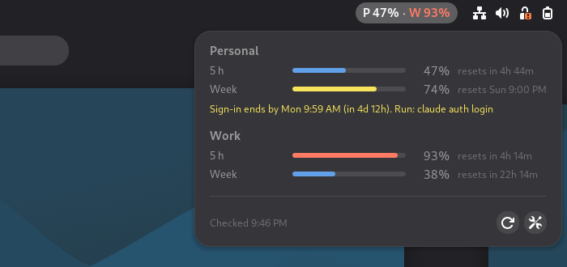

# Claude Usage Watch

[](https://github.com/vdw/claude-usage-watch/actions/workflows/ci.yml)

Unofficial GNOME Shell extension. It shows the 5-hour and weekly Claude Code usage limits of several accounts in the top bar.

Website: <https://vdw.github.io/claude-usage-watch/>

Other usage extensions read one `~/.claude` folder. This one reads any number of Claude Code profiles (`CLAUDE_CONFIG_DIR` folders), for example a personal and a work subscription.



## What it shows

- **Top bar:** one tag per account, such as `P 47% · W 93%`. The colour changes at the warning (70 %) and critical (90 %) thresholds. A dimmed tag means the last poll failed and the number is old. `!` means the account has no data (signed out, missing credentials, CLI not found).
- **Dropdown:** for each account, a bar for the 5-hour session and one bar per weekly limit. Each bar shows when the limit resets. The dropdown also warns when a sign-in ends in less than 5 days.
- **Footer:** the time of the last check, a refresh button and a preferences button.

## How it works

Every 5 minutes the extension runs this command once per account, one account after another:

```
claude -p --no-session-persistence --setting-sources "" --output-format json /usage
```

- `/usage` is a local command. It uses no tokens and takes about 1 second.
- For the default profile the extension leaves `CLAUDE_CONFIG_DIR` unset. For other profiles it sets the variable to the profile folder.
- `--setting-sources ""` skips your hooks, plugins and MCP servers. `--no-session-persistence` writes no session transcript.
- The command runs in `~/.cache/claude-usage-watch`, so it reads no project's `CLAUDE.md`.
- `DISABLE_AUTOUPDATER=1` stops a poll from starting a Claude Code update.
- coreutils `timeout` stops a command after 20 seconds and kills its whole process group.

Before each run the extension checks that the profile folder has a `.credentials.json` file. Without this check the CLI would create a new, empty profile at a mistyped path.

## Requirements

- GNOME Shell 48.
- Claude Code, signed in with a Claude subscription in each profile you add.

## Install

1. Download `claude-usage-watch@vdw.github.io.shell-extension.zip` from the [latest release](https://github.com/vdw/claude-usage-watch/releases/latest), or build it with `tools/pack.sh`.
2. Install it: `gnome-extensions install --force claude-usage-watch@vdw.github.io.shell-extension.zip`.
3. Log out and log in again. Wayland sessions load new extensions only at login.
4. Enable it: `gnome-extensions enable claude-usage-watch@vdw.github.io`.

For development, link the repository instead of installing the zip:

```
glib-compile-schemas schemas/
ln -s "$PWD" ~/.local/share/gnome-shell/extensions/claude-usage-watch@vdw.github.io
```

## Preferences

Open them from the dropdown, or run `gnome-extensions prefs claude-usage-watch@vdw.github.io`.

- **Accounts:** add, rename, reorder, turn off or remove profiles. **Detect** adds every `~/.claude` and `~/.claude-*` folder that has credentials. Choose "Default" as the folder for the plain `claude` command.
- **Top bar:** show every account or only the one with the highest usage. Show the 5-hour number, or the higher of the 5-hour and weekly numbers. Set the thresholds.
- **General:** set the poll interval and the path to `claude`. GNOME Shell's `PATH` often lacks `~/.local/bin`, so the extension also looks in the usual install folders. **Test** runs `claude --version`.

## Troubleshooting

| Dropdown says | Do this |
| :--- | :--- |
| Signed out | Run `claude auth login` with that profile, for example `CLAUDE_CONFIG_DIR=~/.claude-work claude auth login`. |
| No credentials | Check the folder in Preferences. |
| CLI not found | Set the path to `claude` in Preferences. |
| stale since … | The last poll failed. The numbers are from the time shown. The extension retries, and waits longer after each failure in a row (up to 30 minutes). |

Logs: `journalctl -f -o cat /usr/bin/gnome-shell`.

## Development

- Unit tests: `gjs -m tests/run.js`. They use the real CLI outputs in `tests/fixtures/`.
- Live check against your accounts: `gjs -m tests/live.js '' ~/.claude-work` (`''` is the default profile).
- Stylesheets: edit `tools/stylesheet.css.in`, then run `tools/gen-css.py`. It writes `stylesheet-dark.css`, `stylesheet-light.css` and the fallback `stylesheet.css`.

### Headless test shell

`tools/devshell.sh` starts a headless GNOME Shell with its own D-Bus session, dconf database and extensions folder. It never touches your real session. It also loads a helper extension that turns on unsafe mode, so the scripts below can drive the shell.

```
tools/devshell.sh &                      # start; set CUW_DEV_ACCOUNTS='[...]' to seed accounts
tools/shell-wait.sh                      # wait until it answers
tools/shell-eval.sh 'Main.panel.statusArea["claude-usage-watch@vdw.github.io"].menu.open(false)'
tools/shell-shot.sh /tmp/shot.png        # screenshot
tools/shell-click.sh 1043 347            # click at screen coordinates
tools/shell-gsettings.sh set org.gnome.shell.extensions.claude-usage-watch display-mode worst
```

GNOME Shell caches ES modules, so restart the test shell after you change the code.

## Layout

| Path | Contents |
| :--- | :--- |
| `extension.js` | Connects the settings, the poller and the indicator, and removes them in `disable()`. |
| `lib/providers/cliProvider.js` | Finds `claude` and runs it for one account. |
| `lib/parsers/usageParser.js` | Reads the JSON envelope and the usage lines. No GNOME imports. |
| `lib/time.js` | Turns reset strings into times, and formats countdowns. |
| `lib/snapshot.js` | Turns one CLI run into a `UsageSnapshot`. |
| `lib/poller.js` | Runs one account at a time and keeps the last good numbers. Backs off after failures. |
| `lib/accounts.js` | Reads and validates the `accounts` setting. |
| `ui/panelIndicator.js` | Draws the top-bar tags and the dropdown. |
| `prefs.js` | Builds the preferences window. |
| `tests/` | Unit tests and the CLI outputs they use. |
| `tools/` | The packaging script, the stylesheet generator and the headless test shell. |
| `docs/` | The website, published with GitHub Pages. |

## License

GPL-2.0-or-later. See `LICENSE`.

This is an unofficial project. It is not affiliated with or endorsed by Anthropic. Claude and Claude Code are trademarks of Anthropic.
